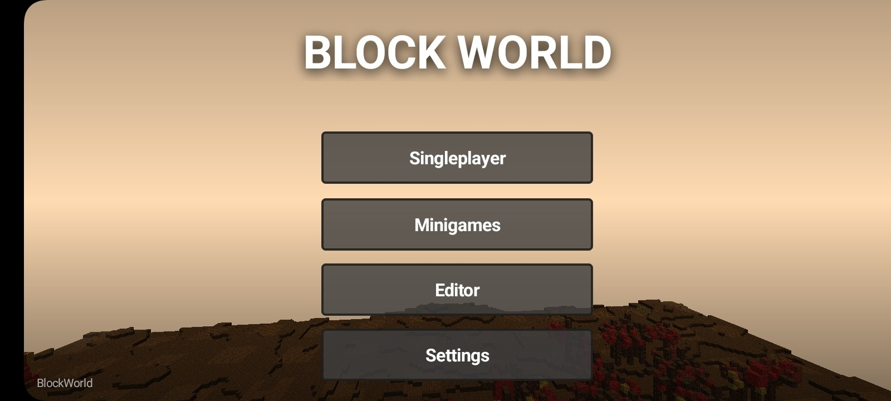
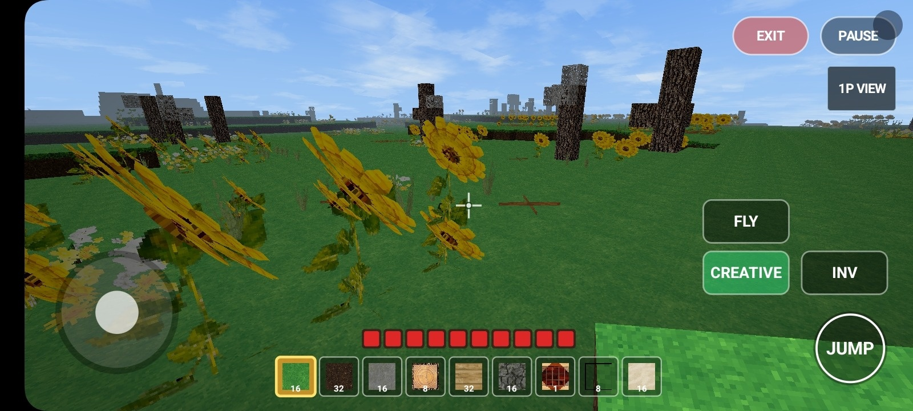
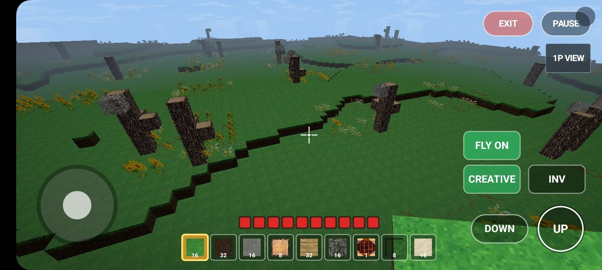
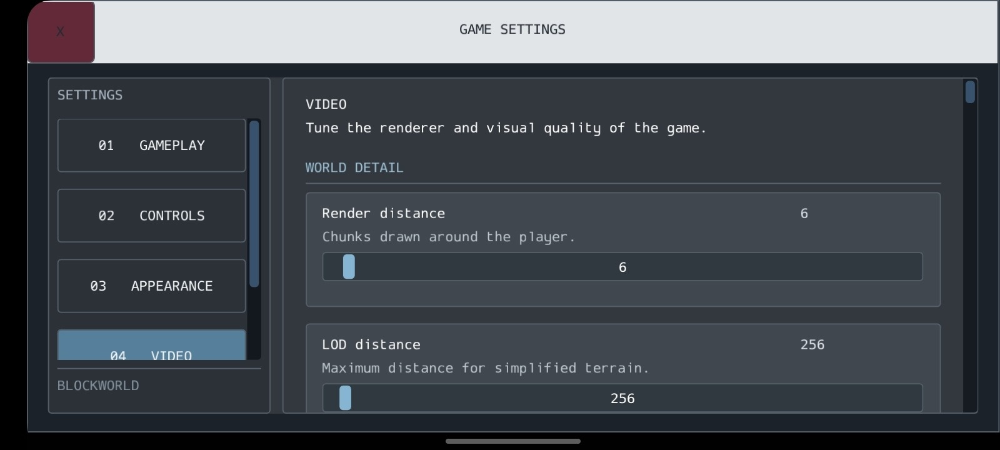

# BlockWorld

Voxel sandbox game for Android with a native C++/OpenGL engine, procedural world generation, and block/fluid physics.

## Status

This project is still in development. Current features:

- Procedural terrain generation with biomes
- Creative mode with flight and block placement
- Touch controls (movement joystick, jump, fly, inventory)
- Day/night cycle
- Basic water and fire simulation
- In-game settings (render distance, LOD distance, controls, appearance)
- Minigames menu and a basic world editor (early stage)

Planned / work in progress:

- Survival mode (health, hunger, crafting progression)
- Full block collision and physics
- World saving/loading improvements
- More biomes, blocks and items

## Screenshots

### Main Menu

### Gameplay

### Settings

